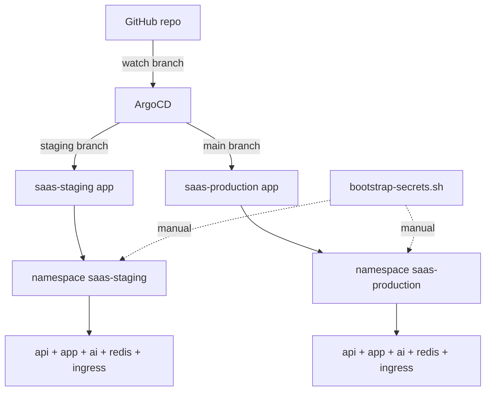

# ArgoCD GitOps

ArgoCD watches [github.com/matchy-plus/matchy-plus](https://github.com/matchy-plus/matchy-plus) and syncs Kubernetes manifests from `deploy/k8s/overlays/`.

## GitOps flow



## Install ArgoCD

```bash
kubectl create namespace argocd
kubectl apply -n argocd -f https://raw.githubusercontent.com/argoproj/argo-cd/stable/manifests/install.yaml
```

## Bootstrap

```bash
kubectl apply -f deploy/argocd/projects/
kubectl apply -f deploy/argocd/app-of-apps.yaml
```

## Applications

| Application | Git branch | Manifest path | Namespace |
| --- | --- | --- | --- |
| `saas-staging` | `staging` | `deploy/k8s/overlays/staging` | `saas-staging` |
| `saas-production` | `main` | `deploy/k8s/overlays/production` | `saas-production` |

Repository URL in all manifests:

`https://github.com/matchy-plus/matchy-plus.git`

## Sync policy

Applications use automated sync with self-heal and `CreateNamespace=true`.

## Secrets

Create secrets before the first sync:

```bash
./deploy/scripts/bootstrap-secrets.sh saas-staging .env.staging
./deploy/scripts/bootstrap-secrets.sh saas-production .env.production
```

Verify the API secret includes `TRUST_PROXY=true` before syncing so Fastify trusts
forwarded client IPs behind Ingress:

```bash
kubectl -n saas-staging get secret saas-api-env -o jsonpath='{.data.TRUST_PROXY}' | base64 -d && echo
kubectl -n saas-production get secret saas-api-env -o jsonpath='{.data.TRUST_PROXY}' | base64 -d && echo
```

ArgoCD syncs manifests only — it does not create application secrets.
