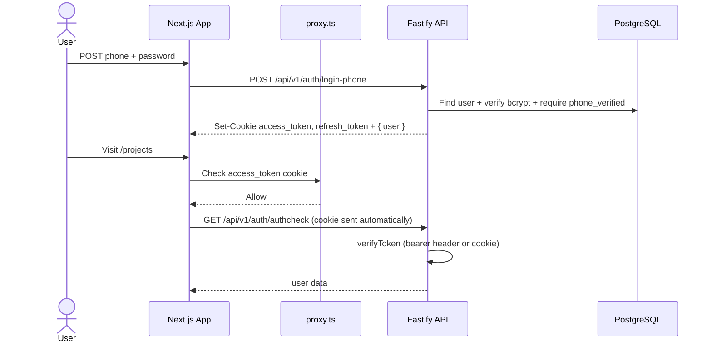
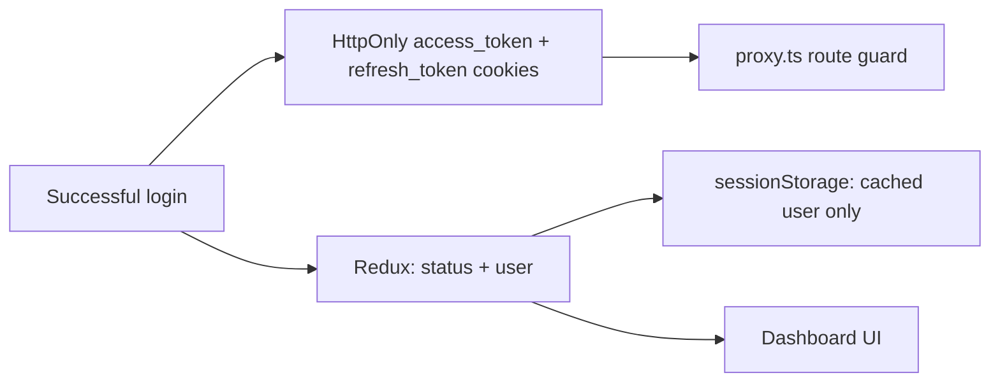

# Authentication

End-to-end authentication flow between the Next.js frontend and Fastify API. This is the
binding reference for member authentication — code comments across the auth services that
say "see doc/reviews/authentication-contract.md" mean this file (that path was a
gitignored, never-committed local note; this committed doc is the real contract).

## Overview

**Member login is phone + password, Google, or LinkedIn only.** Email/password for
members does not exist — email is OAuth-only. **OTP is never a login mechanism** —
it only proves phone ownership for signup, phone linking, or password reset.

Both session tokens (access + refresh) live in **HttpOnly cookies** the API sets itself;
neither is ever present in a JSON response body or readable from frontend code.



## Signup (phone + password, OTP-verified)

Signup is a three-step flow — sending and verifying an OTP only proves phone ownership;
it never creates a user or a session by itself. `register-phone` is the only place an
account is actually created.

1. `POST /api/v1/auth/otp/send` — `{ phone }`. Creates a `SIGNUP_VERIFICATION` OTP
   challenge (see [OTP challenges](#otp-challenges)) and sends it via TunisieSMS.
2. `POST /api/v1/auth/otp/verify` — `{ phone, code }`. Verifies the code and, on
   success, issues a one-time **signup grant** (`signupToken`) tied to that phone.
   Response: `{ verified: true, phone, signupToken }` — no tokens, no user, no session.
3. `POST /api/v1/auth/register-phone` — `{ phone, password, signupToken, name? }`.
   Consumes the signup grant (rejecting a missing/expired/already-used one as
   `invalid_signup_grant`), creates the account with `phone_verified: true`, and sets
   the session cookies.

**Frontend**: `apps/app/src/components/auth/register-form.tsx` drives this exact
sequence — send code, verify code (capturing `signupToken`), then register.

## Login (phone + password)

**API**: `POST /api/v1/auth/login-phone` — `{ phone, password }`.

Requires the account to have a password **and** `phone_verified: true`. Every failure
mode (unknown phone, no password set, unverified phone, wrong password) rejects with
the same generic `invalid_credentials` (401) so none of them can be distinguished from
one another.

`phone_verified` becomes `true` either through the signup grant above, or through
[phone linking](#phone-linking) confirming an OTP for an existing OAuth account.

**Frontend**: `apps/app/src/components/auth/login-form.tsx` — phone + password is the
only login form; there is no OTP-based login step anywhere in the UI.

## OTP challenges

**Service**: `apps/api/src/services/otp-challenge.ts`

Every OTP code is generated, hashed, and verified by this app itself — TunisieSMS only
delivers the text message, it does not manage the OTP lifecycle (unlike the Twilio
Verify integration this replaced). Purposes are scoped with the `OtpPurpose` enum:

- `SIGNUP_VERIFICATION` — proves phone ownership before an account exists.
- `PHONE_LINK` — proves ownership of a phone being attached to an existing OAuth account.
- `PASSWORD_RESET` — proves ownership before allowing a password change.

Each `OtpChallenge` row stores only a hash of the code (`VERIFICATION_CODE_SECRET`
HMAC), an expiry, and an attempt counter — never the plaintext code. A partial unique
index (`(phone, purpose) WHERE consumed_at IS NULL`) enforces at most one active
challenge per phone+purpose at a time; requesting a new one before that cooldown elapses
fails with `otp_resend_too_soon`. Every failure mode (no active challenge, expired, too
many attempts, wrong code) rejects with the same generic `invalid_otp`.

Tunable via environment: `OTP_TTL_MINUTES`, `OTP_MAX_ATTEMPTS`,
`OTP_RESEND_COOLDOWN_SECONDS`, `OTP_SIGNUP_GRANT_TTL_MINUTES` (see
[Environment variables](#environment-variables)).

## SMS delivery (TunisieSMS)

**Client**: `apps/api/src/lib/sms.ts`

A GET request to TunisieSMS's API with the message text and destination number.
Optional at startup — the API boots without `TUNISIESMS_KEY`; OTP-dependent endpoints
instead fail at request time with `sms_service_not_configured` (503). A non-`200`
`status_code` in the response, or the request itself failing, is reported as
`sms_delivery_failed` (502) — the request URL and its parameters (which carry the API
key and the OTP text) are never logged.

### Client-side session storage



Neither token is ever readable from **browser** frontend code — both leave the API only as
HttpOnly cookies (`apps/api/src/utils/member-session.ts`), attached automatically by
the browser on same-site requests. `apps/app/src/lib/api.ts`'s axios instance uses
`withCredentials: true` and, on the web, never attaches an `Authorization` header itself.

**Capacitor exception:** see [Mobile (Capacitor)](#mobile-capacitor).

Since no token is JS-visible on the web, "authenticated" can only be known by asking the API.
`AuthState.status` (`unknown | authenticated | unauthenticated`) starts as `'unknown'`
on every page load; `useBootstrapSession` (`apps/app/src/features/auth/hooks`) always
calls `GET /api/v1/auth/authcheck` once at mount to resolve it — a `status` value
carried over by redux-persist from a previous session is never trusted on its own,
since the cookie it implies may have since expired. Only the **user profile** (not a
token) is cached in `sessionStorage`, for fast optimistic rendering while that check
resolves. See `apps/app/src/lib/auth.ts`.

## Mobile (Capacitor)

**Shell**: `apps/mobile` — Capacitor wraps the live Next.js member app via
`CAPACITOR_SERVER_URL` (remote WebView). See `apps/mobile/README.md`.

Cross-origin WebViews cannot reliably use the browser cookie session alone, so native
clients opt into Bearer auth. Body JWTs are **not** gated on a spoofable header alone:

1. Cap attaches `X-Matchy-Client: mobile` **and** `X-Matchy-Mobile-Key` matching
   `MOBILE_CLIENT_SECRET`. The key comes from the native `MobileClient` plugin
   (`BuildConfig`), not from `NEXT_PUBLIC_*` or the web bundle — a normal browser
   cannot forge it.
2. Session-issuing routes still set HttpOnly cookies for everyone. They return
   `accessToken` + `refreshToken` in JSON **only** when the request is an
   authorized mobile client (label + secret). If `MOBILE_CLIENT_SECRET` is unset,
   body issuance is disabled (fail closed).
3. Cap stores those JWTs in **Capacitor Preferences** (`apps/app/src/lib/mobile-tokens.ts`),
   hydrated into an in-memory cache at bootstrap for sync Axios use, and attaches
   `Authorization: Bearer …` on axios calls. Legacy `localStorage` keys are migrated once.
4. `POST /auth/refresh` accepts `{ refreshToken }` in the body **only** for authorized
   mobile clients (body is preferred when both body and cookie are present). If the body
   token is stale/revoked but the HttpOnly cookie is still valid, refresh falls back to
   the cookie. Any successful refresh for an authorized Cap client returns rotated
   `accessToken` / `refreshToken` in JSON so Bearer storage stays fresh. Browsers lack
   the mobile secret, so spoofing `X-Matchy-Client` alone never yields body JWTs.
5. `verifyToken` already accepts Bearer (see [API authorization](#api-authorization)).
6. Realtime WebSocket: Cap sends `{ event: "auth", payload: { access_token } }` as the
   first frame after upgrade (JWT stays out of the URL / access logs). Web still uses the
   HttpOnly cookie on the handshake. Query-string `?access_token=` is **not** accepted.
7. A non-HttpOnly `access_token` cookie is mirrored onto the **Next.js app origin** (Max-Age
   from JWT `exp`) so `proxy.ts` can still gate routes when `MEMBER_COOKIE_DOMAIN` does not
   cover the WebView host (local emulator).

Browser clients never send the mobile key and never receive tokens in the body — the
cookie-only contract above is unchanged for them.

## Route protection (Next.js)

**File**: `apps/app/src/proxy.ts`

| Condition                                       | Action               |
| ------------------------------------------------ | -------------------- |
| No `access_token` cookie + protected route       | Redirect to `/login` |
| Has `access_token` cookie + `/login`             | Redirect to `/`       |
| Otherwise                                        | Continue             |

> This is an **optimistic cookie check** only — it does not verify JWT signatures. Real
> authorization happens on the API. The cookie is set by the API (not this app), but
> middleware can still read it from the `Cookie` header the browser sends alongside
> every request — `HttpOnly` only blocks `document.cookie` access from JS in the
> browser, not server-side header inspection.

## API authorization

**Plugin**: `apps/api/src/plugins/authorization.ts`

Protected routes use `preHandler: [fastify.verifyToken]`, which accepts the access
token from either source:

1. `Authorization: Bearer <token>` header (Capacitor and non-browser clients) — always wins.
2. **Route-aware cookie only** — never `admin ?? member`:
   - `/api/v1/admin/*` → `admin_access_token` only
   - everything else → `access_token` (member) only

JWTs carry `aud: 'member' | 'admin'` and `tv` (user `token_version`). Verification
rejects the wrong audience for the route, a mismatched `tv`, or a non-`ACTIVE` user.
Member login clears the admin cookie; admin login clears member cookies.

`ACCESS_TOKEN_TTL` may be a duration string (`1h`) or integer seconds; cookie `maxAge`
uses the same parsed seconds as JWT `expiresIn` (`config.accessTokenTtlSeconds`).

**API**: `GET /api/v1/auth/authcheck` (auth required)

Response:

```json
{
  "user": {
    "id": "clx...",
    "email": "jane@example.com",
    "phone": "+21612345678",
    "name": "Jane Doe",
    "auth_provider": "phone",
    "email_verified": false,
    "role": "USER"
  }
}
```

These are exactly the safe profile fields `apps/app` needs to render the logged-in
state — password, refresh tokens, OTP code hashes, and any other internal field are
never selected, let alone returned.

## Refresh tokens

**API**: `POST /api/v1/auth/refresh`

Every successful login/registration/OAuth-exchange issues an **access token**
(short-lived JWT, `ACCESS_TOKEN_TTL`) and a **refresh token** (long-lived,
`REFRESH_TOKEN_TTL_DAYS`), both as HttpOnly cookies. For browser clients they are
**never** in the response body. Capacitor clients that send `X-Matchy-Client: mobile`
also receive the pair in the JSON body (see [Mobile (Capacitor)](#mobile-capacitor)).
Refresh tokens are stored server-side as a `RefreshToken` row keyed by a **sha256
hash** of the token — the raw token itself is never persisted. The refresh cookie is
scoped to `Path=/api/v1/auth` — the browser never attaches it to any other request,
shrinking where a stolen refresh token could otherwise be replayed from.

`POST /api/v1/auth/refresh` takes the refresh token from its HttpOnly cookie, or —
for Capacitor — from an optional `{ refreshToken }` body, and **rotates** it: the
presented token is looked up by its hash, checked for revocation/expiry, then
**atomically** consumed (`updateMany` where `revoked_at: null`). If consume count is 0
(reuse), the request fails; if the token was revoked more than 30 seconds ago
(a genuine replay, not a benign double-refresh race between two tabs), every refresh
row for that user is also revoked. Both new cookies are set on the response (and body
tokens again for mobile).

`POST /api/v1/auth/logout` reads the refresh cookie, best-effort revokes it, and
clears both cookies regardless of whether revocation succeeded. Changing your password
(member or admin) or confirming a password reset bumps `User.token_version` and revokes
**every** refresh token (`revokeAllSessions`), so outstanding access JWTs also fail
verification immediately.

### Admin refresh tokens

**API**: `POST /api/v1/auth/admin/refresh`

The admin panel has its own refresh token, issued alongside the access JWT on
`POST /api/v1/auth/admin/login` and stored as a separate `admin_refresh_token`
HttpOnly cookie (path-scoped to `/api/v1/auth/admin`). It reuses the exact same
`RefreshToken` table, rotation, and reuse-detection as the member flow —
`TokenService.refreshAccessToken` takes an `audience` option and re-signs the access
token for whichever audience the caller asked for — but with one deliberate
difference: `ADMIN_REFRESH_TOKEN_TTL` is far shorter than `REFRESH_TOKEN_TTL_DAYS`
(hours, not weeks). A stolen admin session staying silently renewable for a member's
full 30-day window is a much bigger blast radius than a regular account, so an idle
admin is forced back through a real login sooner. Refreshing also re-checks the
account is still an admin role (`isAdminRole`) — a demotion between login and refresh,
or a member's own refresh token presented at this route, cannot mint a fresh
admin-audience access token just because the underlying refresh token is still valid.

## Phone linking

**API**: `POST /api/v1/auth/phone-link/request` (auth required) → `POST /api/v1/auth/phone-link/confirm` (auth required)

Lets a user who signed up via a social provider (Google/LinkedIn — see
`SOCIAL_AUTH_PROVIDERS` in `apps/api/src/constants.ts`) attach a phone number to their
account, using a `PHONE_LINK`-purpose OTP challenge:

1. `request` takes `{ phone }`; rejects if the account isn't a social-auth account,
   already has a phone linked, or the phone is already registered to someone else —
   then sends an OTP.
2. `confirm` takes `{ phone, code }` and **re-checks the same eligibility** (provider +
   not-already-linked) **at confirm time**, not just at request time, before verifying
   the OTP and writing the phone. A successful confirm also sets `phone_verified: true`
   — a completed OTP check is real proof of ownership, the same as signup, making the
   account eligible for phone+password login going forward.

   Verification is also bound to the confirming caller's `userId`, not just phone +
   code (`OtpChallengeService.verifyChallenge`'s `expectedUserId` param) — otherwise any
   authenticated caller who obtained a valid code could confirm a challenge that was
   requested by a different account.

Both endpoints are rate-limited the same way as OTP send (`request`: 5 per 15 minutes).

## Password reset (phone + OTP)

**API**: `POST /api/v1/auth/password-reset/request` → `POST /api/v1/auth/password-reset/confirm`

1. `request` takes `{ phone }` and always returns the same uniform success response,
   whether or not that phone has a password-based account — an OTP (`PASSWORD_RESET`
   purpose) is only actually sent when it does, so the response can't be used to probe
   which phones have accounts.
2. `confirm` takes `{ phone, code, newPassword }`, verifies the OTP, updates the
   password without touching `auth_provider`, and revokes every existing refresh token
   on the account.

## Google & LinkedIn OAuth

First-party OAuth via [`@fastify/oauth2`](https://github.com/fastify/fastify-oauth2) — no third-party auth provider (Clerk, Auth0, etc.) is used or planned.

**Plugin**: `apps/api/src/plugins/oauth.ts` registers a separate `@fastify/oauth2` instance per provider (`oauth2Google`, `oauth2LinkedIn`), each providing its own `/api/v1/auth/oauth/<provider>` start-redirect route with built-in state/CSRF cookie handling. **Each provider is independent and optional**: it's only registered when both its client id and secret are set (`GOOGLE_CLIENT_ID`/`GOOGLE_CLIENT_SECRET`, `LINKEDIN_CLIENT_ID`/`LINKEDIN_CLIENT_SECRET`) — a missing pair disables just that provider's route, the API still starts normally, and the other provider is unaffected.

**Callbacks**: `GET /api/v1/auth/oauth/google/callback` and `GET /api/v1/auth/oauth/linkedin/callback`, implemented in `routes/v1/auth/actions.ts` (kept alongside the other auth routes; only the two `@fastify/oauth2` plugin instances live in `plugins/oauth.ts`). Profile-fetching is delegated to dedicated helpers — `lib/google-oauth.ts` / `lib/linkedin-oauth.ts` — each calling the provider's OIDC `userinfo` endpoint with the access token `@fastify/oauth2` already validated. `GOOGLE_REDIRECT_URI` / `LINKEDIN_REDIRECT_URI` must match those paths (and the provider console) exactly.

On a successful callback:

1. If an `oauth_link_intent` cookie is present (set by authenticated
   `GET /api/v1/auth/oauth/<provider>/link`), the provider is attached to the logged-in
   user (`linkOAuthProvider`) and the browser redirects to
   `${FRONTEND_URL}/account-profile?linked=<provider>`. Provider email must be verified;
   email must match the account (or the account has no email); conflicts redirect with
   `?error=`.
2. Otherwise `findOrCreateOAuthUser` looks up by provider id; if none exists and email
   matches an existing account, it merges **only when** `profile.emailVerified === true`
   (otherwise `oauth_email_unverified`); else it creates a new user.
3. A short-lived, single-use **exchange code** is minted and the browser is redirected to
   `${FRONTEND_URL}/oauth-callback?code=...` (or `?error=...` on failure).

**Exchange codes** (`OAuthExchangeCode` table): only a **sha256 hash** of the code is stored, never a token — alongside `user_id`, `expires_at`, and `consumed_at` (null until used). The SPA calls `POST /api/v1/auth/oauth/exchange` with `{ code }`; `consumeExchangeCode` rejects a code that's missing, expired, or already consumed (`invalid_exchange_code`), otherwise marks it consumed and — **only at this point** — calls the existing `TokenService.issueTokenPair()` to mint a real access/refresh token pair, set as cookies. No tokens exist anywhere until a valid code is actually exchanged.

**Frontend**: `apps/app/src/components/auth/oauth-callback.tsx` reads `?code=`/`?error=`,
calls the exchange endpoint, and routes into the app on success — the same
`resolvePostAuthDestination` next-param handling used by the phone-password flow (see
[Client-side session storage](#client-side-session-storage)). Account-profile “Link”
buttons use `/auth/oauth/<provider>/link` (full-page), not the login OAuth start.

## Logout

**Frontend**: dispatches the `logout()` thunk, which POSTs `/api/v1/auth/logout` (no
body — best-effort) then clears Redux state and the cached user in `sessionStorage`.
The API clears both HttpOnly cookies on its response; the frontend cannot clear them
itself.

## Account deletion

**API**: `DELETE /api/v1/auth/account` (auth required)

```json
{
  "confirm": true,
  "currentPassword": "required when the account has a password",
  "otpCode": "required when the account has no password (ACCOUNT_DELETE OTP)",
  "reason": "optional, logged server-side only"
}
```

Passwordless accounts must call `POST /api/v1/auth/account/delete-otp` first (SMS to the
linked phone). Session alone is never enough to delete.

- `confirm: true` is **always required** (`account_deletion_not_confirmed`, 400).
- If the account **has a password**, `currentPassword` is required and verified.
- If the account **has no password**, a fresh `ACCOUNT_DELETE` OTP (`otpCode`) is required.
- `reason` is optional and logged server-side only.
- Rate-limited with `RATE_LIMIT_STRICT` (3/hour).
- **Hard delete** via `prisma.user.delete()` with cascade on refresh/OAuth/OTP rows.

> `/verify-account` (face KYC) and paid-plan screens may still be product stubs — they are
> not auth-session bugs. The admin panel’s readable `admin_session=1` marker is edge UX
> only; the API always authorizes against the HttpOnly `admin_access_token` JWT, which
> the admin panel now keeps alive via its own refresh token — see
> [Admin refresh tokens](#admin-refresh-tokens).
- The response body is `{ message }` only; no user object (and therefore no password field) is ever returned.

## CSRF: Origin/Referer validation

**Plugin**: `apps/api/src/plugins/origin-guard.ts`

Now that sessions ride on cookies the browser attaches automatically, every
state-changing request (`POST`/`PUT`/`PATCH`/`DELETE`) across the whole API — not just
auth routes — is checked against `CORS_ORIGINS` (the same allowlist `plugins/cors.ts`
already uses): if the request presents an `Origin` (or, failing that, a `Referer`)
that isn't one of the deployed frontends, it's rejected with `origin_not_allowed`
(403). A request with neither header — a non-browser client authenticating with its
own bearer token, not an ambient cookie — passes through unchecked, since there is
nothing here for this specific defense to protect against. `SameSite=Lax` on both
session cookies already blocks most cross-site cookie-bearing requests; this closes
the remaining gap (e.g. a plain HTML form POST) with no separate CSRF-token machinery.

## Environment variables

| Variable                                                                                      | Used by                                                                                                                                                           |
| ---------------------------------------------------------------------------------------------- | ------------------------------------------------------------------------------------------------------------------------------------------------------------------------------------------------------------------ |
| `ACCESS_TOKEN_SECRET`                                                                           | API — JWT signing                                                                                                                                                 |
| `ACCESS_TOKEN_TTL`                                                                              | API — token expiry                                                                                                                                                |
| `COOKIE_SECRET`                                                                                 | API — cookie plugin                                                                                                                                               |
| `REFRESH_TOKEN_SECRET`                                                                          | API — refresh token signing (see [Refresh tokens](#refresh-tokens))                                                                                               |
| `REFRESH_TOKEN_TTL_DAYS`                                                                        | API — member refresh token lifetime                                                                                                                                      |
| `ADMIN_REFRESH_TOKEN_TTL`                                                                       | API — admin refresh token lifetime (see [Admin refresh tokens](#admin-refresh-tokens))                                                                            |
| `VERIFICATION_CODE_SECRET`                                                                      | API — HMAC key used to hash phone OTP codes before storage (never the plaintext code)                                                                            |
| `TUNISIESMS_KEY` / `TUNISIESMS_SENDER`                                                          | API — phone OTP delivery (optional at startup; required only for OTP-dependent endpoints, see [SMS delivery](#sms-delivery-tunisiesms))                          |
| `OTP_TTL_MINUTES` / `OTP_MAX_ATTEMPTS` / `OTP_RESEND_COOLDOWN_SECONDS` / `OTP_SIGNUP_GRANT_TTL_MINUTES` | API — OTP challenge lifecycle tuning (optional, sensible defaults — see [OTP challenges](#otp-challenges))                                                        |
| `GOOGLE_CLIENT_ID` / `GOOGLE_CLIENT_SECRET` / `LINKEDIN_CLIENT_ID` / `LINKEDIN_CLIENT_SECRET`   | API — Google/LinkedIn OAuth (optional per provider, see [environment variables](../setup/environment-variables.md#google--linkedin-oauth--optional-per-provider)) |
| `API_BASE_URL` / `FRONTEND_URL`                                                                 | API — OAuth callback URL and SPA redirect target                                                                                                                  |
| `OAUTH_EXCHANGE_CODE_TTL_SECONDS`                                                                | API — OAuth exchange code lifetime (default 60s)                                                                                                                  |
| `CORS_ORIGINS`                                                                                   | API — allowed browser origins, shared by the CORS plugin and the Origin/Referer CSRF guard (see [CSRF](#csrf-originreferer-validation))                          |
| `MOBILE_CLIENT_SECRET`                                                                           | API + Cap Android build — shared secret for authorized Capacitor body JWTs (see [Mobile (Capacitor)](#mobile-capacitor)); never `NEXT_PUBLIC_*`                 |
| `ADMIN_COOKIE_DOMAIN` / `MEMBER_COOKIE_DOMAIN`                                                   | API — cookie `Domain` attribute, only needed when the API and the panel/app sit on different subdomains                                                          |

## Security notes

- Never store raw passwords — only bcrypt hashes
- JWT secret must be long and random in production
- `NEXT_PUBLIC_*` vars must not contain secrets
- Both session tokens are HttpOnly cookies for **browser** clients — never in a JSON
  body, never readable from web JS. Capacitor is the documented exception
  (`X-Matchy-Client: mobile` → body tokens + Bearer); see [Mobile (Capacitor)](#mobile-capacitor)
- Proxy cookie check is UX-only; always validate tokens server-side
- Origin/Referer validation is defense-in-depth for CSRF, not a substitute for
  `SameSite=Lax`

## Extending auth

Common next steps:

- Role-based access control (extend User model + admin autohooks)
- Full identity/profile onboarding after signup (tracked as separate follow-up work,
  not part of this contract)

Admin routes already have a hook scaffold at `apps/api/src/routes/v1/admin/autohooks.ts`.
