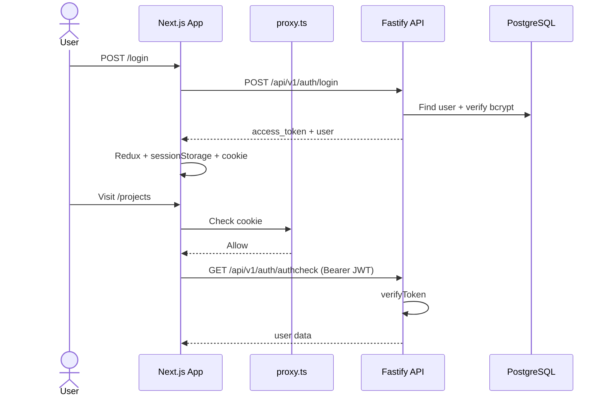
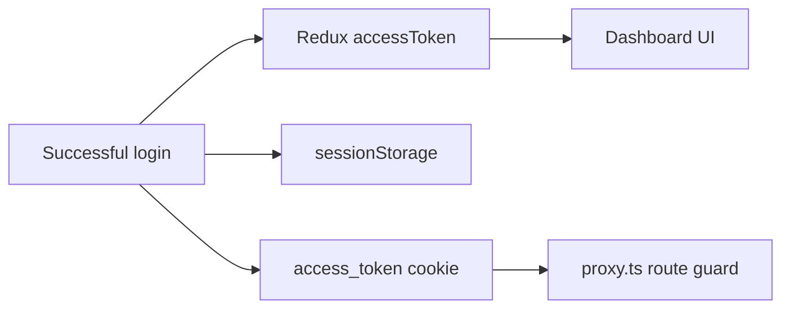

# Authentication

End-to-end authentication flow between the Next.js frontend and Fastify API.

## Overview



## Registration

**Frontend**: `apps/app/src/components/auth/register-form.tsx`

**API**: `POST /api/v1/auth/register`

```json
{
  "name": "Jane Doe",
  "email": "jane@example.com",
  "password": "securepassword"
}
```

Passwords are hashed with **bcrypt** before storage.

## Login

**Frontend**: `apps/app/src/components/auth/login-form.tsx`

**API**: `POST /api/v1/auth/login`

Response:

```json
{
  "access_token": "eyJhbG...",
  "user": {
    "id": "clx...",
    "name": "Jane Doe",
    "email": "jane@example.com"
  }
}
```

### Client-side session storage



On successful login (`features/auth/store/auth-slice.ts`):

1. Token stored in **Redux** (`accessToken`)
2. Token stored in **sessionStorage** (`access_token`)
3. User stored in **sessionStorage** (`user`)
4. Token written to **cookie** (`access_token`) for route proxy

See `apps/app/src/lib/auth.ts`.

## Route protection (Next.js)

**File**: `apps/app/src/proxy.ts`

| Condition | Action |
| --- | --- |
| No cookie + protected route | Redirect to `/login` |
| Has cookie + auth route (`/login`, `/register`) | Redirect to `/` |
| Otherwise | Continue |

> This is an **optimistic cookie check** only — it does not verify JWT signatures. Real authorization happens on the API.

## API authorization

**Plugin**: `apps/api/src/plugins/authorization.ts`

Protected routes use `preHandler: [fastify.verifyToken]`:

1. Extract `Authorization: Bearer <token>` header
2. Verify JWT with `ACCESS_TOKEN_SECRET`
3. Attach decoded user to `request.loggedUser`

Example protected route:

```
GET /api/v1/auth/authcheck
Authorization: Bearer eyJhbG...
```

## Email verification

**API**: `POST /api/v1/auth/email-verification/request` (auth required) → `POST /api/v1/auth/email-verification/confirm` (auth required)

1. `request` takes `{ email }`, rejects it if another account already uses that email (`email_already_used`), and — if SMTP is configured — emails a 6-digit code and stores its **sha256 hash** (not the plaintext code) on the user record alongside the pending email and a 30-minute expiry.
2. `confirm` takes `{ code }`, hashes it and compares against the stored hash; on match the pending email becomes the user's real `email` and `email_verified` is set to `true`.
3. If SMTP isn't configured (see [Environment variables](../setup/environment-variables.md#email-smtp--optional)), `request` fails with `smtp_not_configured` (503) rather than the server refusing to boot.

Both endpoints are rate-limited the same way as OTP send (`request`: 5 per 15 minutes).

## Phone linking

**API**: `POST /api/v1/auth/phone-link/request` (auth required) → `POST /api/v1/auth/phone-link/confirm` (auth required)

Lets a user who signed up via a social provider (Google/LinkedIn — see `SOCIAL_AUTH_PROVIDERS` in `apps/api/src/constants.ts`) attach a phone number to their account, reusing the Twilio Verify OTP flow:

1. `request` takes `{ phone }`; rejects if the account isn't a social-auth account, already has a phone linked, or the phone is already registered to someone else — then sends an OTP.
2. `confirm` takes `{ phone, code }` and **re-checks the same eligibility (provider + not-already-linked) at confirm time**, not just at request time, before verifying the OTP and writing the phone.

Both endpoints are rate-limited the same way as OTP send (`request`: 5 per 15 minutes).

## Google & LinkedIn OAuth

First-party OAuth via [`@fastify/oauth2`](https://github.com/fastify/fastify-oauth2) — no third-party auth provider (Clerk, Auth0, etc.) is used or planned.

**Plugin**: `apps/api/src/plugins/oauth.ts` registers a separate `@fastify/oauth2` instance per provider (`oauth2Google`, `oauth2LinkedIn`), each providing its own `/api/v1/auth/oauth/<provider>` start-redirect route with built-in state/CSRF cookie handling. **Each provider is independent and optional**: it's only registered when both its client id and secret are set (`GOOGLE_CLIENT_ID`/`GOOGLE_CLIENT_SECRET`, `LINKEDIN_CLIENT_ID`/`LINKEDIN_CLIENT_SECRET`) — a missing pair disables just that provider's route, the API still starts normally, and the other provider is unaffected.

**Callbacks**: `GET /api/v1/auth/oauth/google/callback` and `GET /api/v1/auth/oauth/linkedin/callback`, implemented in `routes/v1/auth/actions.ts` (kept alongside the other auth routes; only the two `@fastify/oauth2` plugin instances live in `plugins/oauth.ts`). Profile-fetching is delegated to dedicated helpers — `lib/google-oauth.ts` / `lib/linkedin-oauth.ts` — each calling the provider's OIDC `userinfo` endpoint with the access token `@fastify/oauth2` already validated.

On a successful callback:

1. `services/oauth-authentication.ts`'s `findOrCreateOAuthUser` looks up the user by provider id (`google_id`/`linkedin_id`); if none exists, it links the provider to an existing account with a matching **verified** email, or otherwise creates a new user. An existing account with a matching but **unverified** email is not linked (`oauth_email_not_verified`) — the provider can't yet prove ownership of that email.
2. A short-lived, single-use **exchange code** is minted (`createExchangeCode`) and the browser is redirected to `${FRONTEND_URL}/oauth-callback?code=...`.
3. On failure (profile fetch failure, unverified-email conflict, or a disabled provider), the browser is redirected to `${FRONTEND_URL}/oauth-callback?error=...` instead — a top-level browser redirect can't carry a JSON error body, so there's no HTTP error response to read here.

**Exchange codes** (`OAuthExchangeCode` table): only a **sha256 hash** of the code is stored, never a token — alongside `user_id`, `expires_at`, and `consumed_at` (null until used). The SPA calls `POST /api/v1/auth/oauth/exchange` with `{ code }`; `consumeExchangeCode` rejects a code that's missing, expired, or already consumed (`invalid_exchange_code`), otherwise marks it consumed and — **only at this point** — calls the existing `TokenService.issueTokenPair()` to mint a real access/refresh token pair. No tokens exist anywhere until a valid code is actually exchanged.

> **Frontend note**: the `/oauth-callback` SPA route that reads `?code=`/`?error=` and calls the exchange endpoint is implemented separately, not part of this backend change.

## Logout

**Frontend**: dispatches `logout()` action which:

- Clears Redux state
- Removes sessionStorage entries
- Clears the `access_token` cookie

## Account deletion

**API**: `DELETE /api/v1/auth/account` (auth required)

```json
{
  "confirm": true,
  "currentPassword": "only required if the account has a password",
  "reason": "optional, logged server-side only"
}
```

- `confirm: true` is **always required**, regardless of how the account authenticates — a missing or `false` value is rejected (`account_deletion_not_confirmed`, 400) before anything else is checked.
- If the account **has a password** (email/phone password accounts), `currentPassword` is also required and verified against the stored hash — both a missing and an incorrect password are rejected as `invalid_current_password` (400).
- If the account **has no password** (OTP-only or OAuth-only accounts), no password check applies — `confirm: true` alone is sufficient.
- `reason` is optional and never required; when present it's logged server-side (`request.log.info`) for support/analytics purposes only — it isn't stored on the user record or used in the deletion decision.
- Rate-limited with the strict tier (`RATE_LIMIT_STRICT`: 3 requests per hour) — deliberately tighter than the 5/15min tier used by OTP/email/phone-link "send" endpoints, since this is destructive and hard to undo.
- **This is currently a hard delete**: `prisma.user.delete()` removes the row outright. `RefreshToken` and `OAuthExchangeCode` rows for that user are removed automatically via Prisma's `onDelete: Cascade`. There is no soft-delete flag, `status` enum, or "banned" state on `User` — deleting is permanent and immediate.
- The response body is `{ message }` only; no user object (and therefore no password field) is ever returned.

## Environment variables

| Variable | Used by |
| --- | --- |
| `ACCESS_TOKEN_SECRET` | API — JWT signing |
| `ACCESS_TOKEN_TTL` | API — token expiry |
| `COOKIE_SECRET` | API — cookie plugin |
| `SMTP_HOST` / `SMTP_PORT` / `SMTP_USER` / `SMTP_PASS` / `SMTP_FROM` / `SMTP_FROM_NAME` / `SMTP_SECURE` | API — email verification (optional, see [environment variables](../setup/environment-variables.md#email-smtp--optional)) |
| `GOOGLE_CLIENT_ID` / `GOOGLE_CLIENT_SECRET` / `LINKEDIN_CLIENT_ID` / `LINKEDIN_CLIENT_SECRET` | API — Google/LinkedIn OAuth (optional per provider, see [environment variables](../setup/environment-variables.md#google--linkedin-oauth--optional-per-provider)) |
| `API_BASE_URL` / `FRONTEND_URL` | API — OAuth callback URL and SPA redirect target |
| `OAUTH_EXCHANGE_CODE_TTL_SECONDS` | API — OAuth exchange code lifetime (default 60s) |

## Security notes

- Never store raw passwords — only bcrypt hashes
- JWT secret must be long and random in production
- `NEXT_PUBLIC_*` vars must not contain secrets
- Proxy cookie check is UX-only; always validate tokens server-side
- Consider httpOnly cookies for production hardening

## Extending auth

Common next steps:

- Role-based access control (extend User model + admin autohooks)

Admin routes already have a hook scaffold at `apps/api/src/routes/v1/admin/autohooks.ts`.
