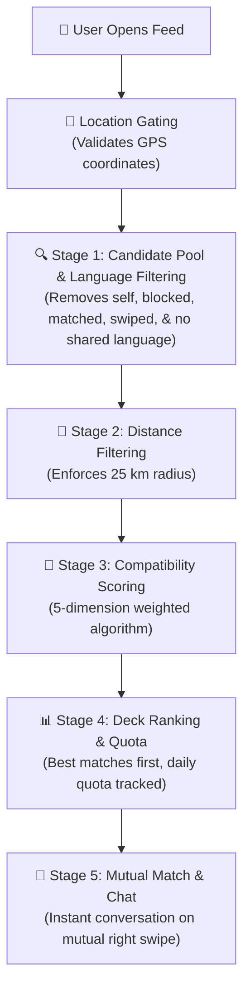

# Matchy+ Matching & Discovery System: Architecture, Mechanics & Weaknesses

---

## 1. Overview

The **Matchy+ Matching System** connects users (job seekers, employers, freelancers, service providers, and professionals) through an interactive swipe feed and search catalog.

The engine filters out ineligible users, calculates a **compatibility score (0–100%)** based on professional goals, skills, sector, language, and geographic proximity, and presents the highest-matching candidates at the top of the deck.

---

## 2. System Architecture & Lifecycle

---

### Stage 1: Candidate Pool & Eligibility Filters

Before evaluating compatibility, candidate profiles must satisfy the following checks:

* **Self Exclusion**: The swiper is excluded from their own deck.
* **Onboarding Verification**: Incomplete profiles (abandoned signups or unverified accounts without complete onboarding) are omitted.
* **Block List**: Bidirectional check on `UserBlock` (neither blocker nor blocked user will see each other).
* **Existing Matches**: Users with active rows in `Match` are filtered out.
* **Swipe History**: Anyone with an existing `SwipeLog` of direction `LEFT` or `RIGHT` is excluded. Swipes marked `WITHDRAWN` remain eligible to re-enter.
* **Language Compatibility**: Both users must share at least one registered spoken language (e.g. French, Arabic, English). Candidates with zero language overlap are excluded.

---

### Stage 2: Location & Proximity Verification

* **GPS Requirement**: Both the swiping user and the candidate must have registered GPS coordinates. Candidates without valid GPS data are excluded.
* **Discovery Radius**: The default production radius is **25 km** (`DISCOVERY_RADIUS_M = 25000`). Distances are calculated using the Haversine formula.

---

### Stage 3: Compatibility Scoring Breakdown (0–100%)

Every eligible candidate is evaluated across **6 weighted dimensions** (aligned with the Figma matching specification):

| Dimension | Weight | Scoring Logic |
| :--- | :---: | :--- |
| **1. Compétences & Intérêts** (`skills`) | **28%** | Jaccard token similarity ($\frac{\text{Overlap}}{\text{Union}} \times 100$) + substring soft match + sector compatibility boost. |
| **2. Proximité géographique** (`proximity`) | **22%** | Smooth exponential decay curve based on distance: $(1 - \frac{\text{dist}}{\text{radius}})^{1.6} \times 100$. |
| **3. Alignement des objectifs** (`goals`) | **18%** | Evaluates complementary professional intentions (Hiring $\leftrightarrow$ Job Seeker = 100%, Service Offer $\leftrightarrow$ Need = 100%, Domain Peer = 90%, Same Intent = 75%, Unmatched = 45%). |
| **4. Disponibilité partagée** (`availability`) | **12%** | Day overlap percentage ($60\%$) + Schedule flexibility ($40\%$). |
| **5. Langues communes** (`languages`) | **10%** | Normalized language Jaccard overlap + 15 pt bonus for $\ge 1$ shared language. |
| **6. Qualité & Réputation** (`quality`) | **10%** | Rating score ($70\%$) + Log review count bonus ($30\%$) + Profile completeness bonus. |

#### Post-Processing & Modifiers

* **Deterministic Jitter**: $\pm 3\text{ pts}$ based on candidate ID seed to avoid visual score ties across re-renders.
* **Score Clamping**: Final score is clamped within **`[40, 99]`** (or up to 100 with reciprocity boost).
* **Reciprocity Boost**: If the candidate has already swiped **RIGHT** on the user, an automatic **+8 point boost** (`RECIPROCITY_BOOST`) is added.

#### Match Classification Groups

1. **Group 1**: *Profil complémentaire* (Strong complementary intents)
2. **Group 2**: *Même domaine pro* (Same professional sector)
3. **Group 3**: *Réseau professionnel* (General professional networking)
4. **Group 4**: *Suggestion* (Suggestions & cross-sector exploratory profiles)

---

### Stage 4: Deck Ranking & Quota Management

1. **Sorting**: Ordered primarily by `match_score DESC`, with ties broken by `match_group ASC` (Group 1 before Group 4).
2. **AI Top Picks Sidebar**: Displays the top 5 next candidate profiles.
3. **Freemium & Quota**: Tracks daily swipe usage per user plan (resets at midnight UTC). In search mode, profiles beyond index #3 are blurred/locked.

---

### Stage 5: Mutual Match & Messaging Hook

* When both users swipe **RIGHT**, a `Match` record is created, a real-time notification is broadcast to both parties, and a private conversation channel is created in the messaging system.

---

## 3. System Weaknesses & Risks

### 1. The Fixed Candidate Window (400-User Window)

* **Mechanism**: The candidate query fetches only the 400 most recent registrations (`take: 400, orderBy: { create_at: 'desc' }`).
* **Risk**: As the user base expands, older active accounts with high compatibility will not enter the evaluation pipeline because they fall outside the 400 newest signup cutoff.

---

### 2. In-Memory Distance Filtering vs Database Geofiltering

* **Mechanism**: Distance filtering is performed in application memory via JavaScript rather than at the database layer (SQL/PostGIS).
* **Risk**: If the 400 most recent signups are concentrated in distant regions (e.g. Tunis), a user in a regional city (e.g. Sousse) may receive an empty candidate set even when eligible nearby profiles exist.

---

### 3. Scripted Keyword Intent Matching

* **Mechanism**: Intent mapping relies on exact keyword matching across French and English word lists.
* **Risk**: Unconventional phrasing or variations in bios cause candidates to default to generic networking intent, dropping the goal dimension score from 100 to 40.

---

### 4. Hard GPS Dependency

* **Mechanism**: Swipes and search feeds strictly require active browser/device GPS coordinates.
* **Risk**: Users on desktop devices or those who refuse browser location permissions are unable to browse profiles by city or region.

---

### 5. Sparse Region Discovery Fallback

* **Mechanism**: When fewer candidates exist within 25 km, the feed terminates with an empty state.
* **Risk**: New regions experience immediate drop-off without automated prompts or one-tap actions to expand search radius to 50 km or 100 km.

---

## 4. Improvement Roadmap

1. **Database Spatial Querying**: Replace `take: 400` with bounding-box or PostGIS queries in PostgreSQL to fetch candidates based on coordinate proximity directly in SQL.
2. **Adaptive Radius Expansion**: Provide an intuitive UI control to expand search radius when fewer than 3 profiles match within 25 km.
3. **City/Postal Code Fallback**: Allow fallback selection of registered city when device GPS is unavailable.
4. **Vector Embedding Reranking**: Utilize asynchronous background processing (`apps/ai`) to compute profile embeddings for semantic matchmaking.
